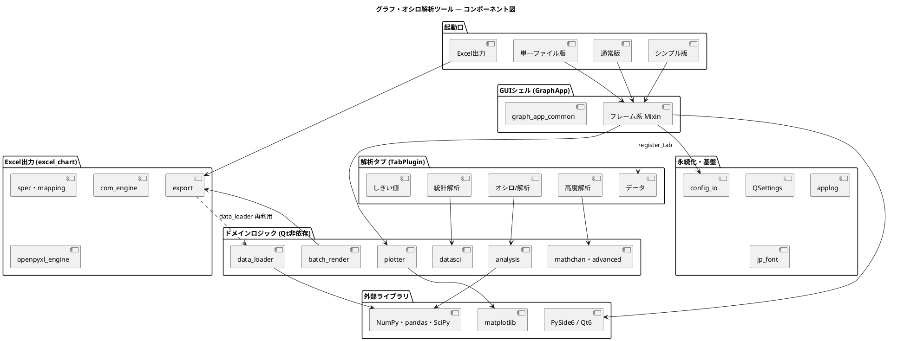

# コンポーネント図（PlantUML 版）

本アプリのコンポーネント構成を PlantUML で記述したものです。仕様書
[仕様書.md](仕様書.md) の「5.1 システム構成図（コンポーネント図）」にある
Mermaid 版と同じ 7 層構成を表します。

- **Obsidian** では、PlantUML プラグイン（`obsidian-plantuml` など）を入れると
  下の ` ```plantuml ` ブロックが図として描画されます。
- **描画バックエンド**: PlantUML はレンダリングに PlantUML サーバまたはローカルの
  Java＋`plantuml.jar` が必要です。既定は公開サーバ（plantuml.com）へ図のテキストを
  送って描画するため、非公開で使うならローカルサーバ／jar の設定を推奨します。
- **GitHub** はこの `plantuml` ブロックを図として描画しません（コードとして表示）。
  GitHub で図を見たい場合は仕様書の Mermaid 版を参照してください。


