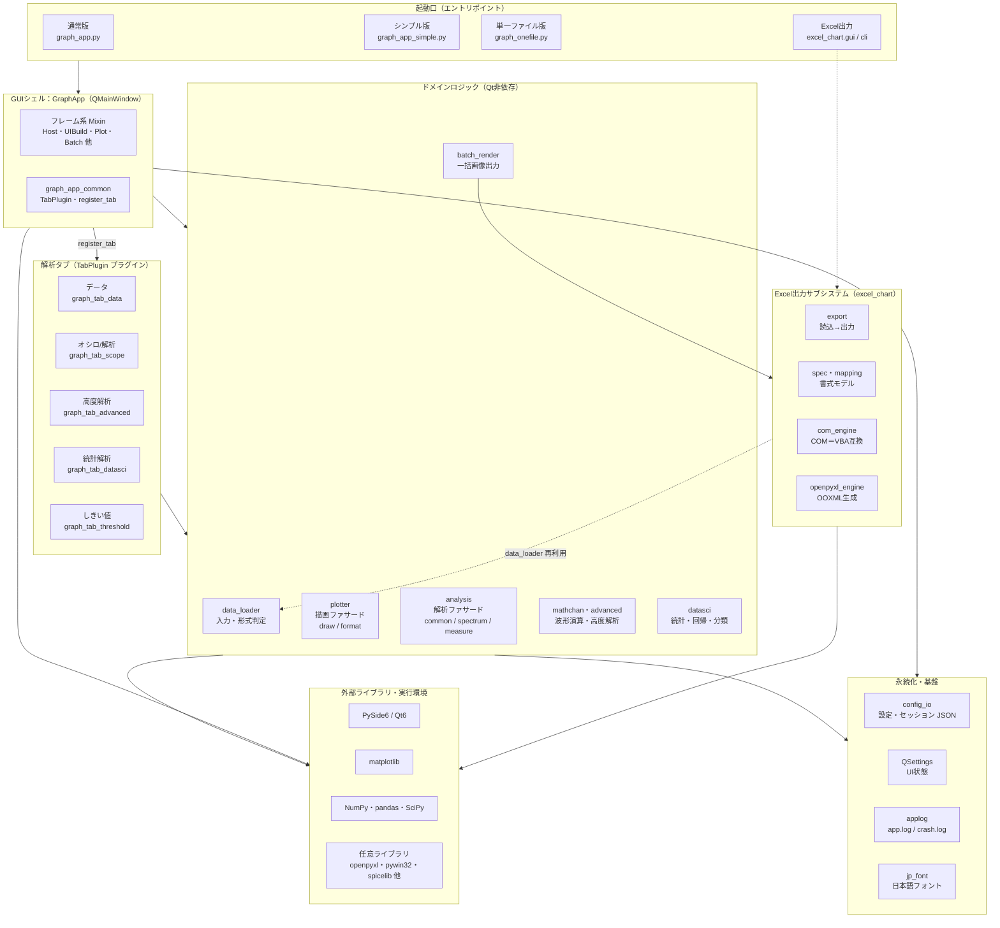

# CSV / TSV / 波形 グラフ・オシロ解析ツール 仕様書

| 項目 | 内容 |
|------|------|
| 文書名 | ソフトウェア仕様書（Software Specification） |
| 対象ソフトウェア | CSV / TSV / 波形 グラフ・オシロ解析ツール |
| 版 | 1.0 |
| 作成日 | 2026-10-25 |
| 対象リビジョン | ブランチ `claude/specification-document-4ed0b4` 時点のソースツリー |

> 本書はソースコードを一次情報として記述した**実装準拠の仕様書**です。
> 操作手順の詳細は [README.md](../README.md)・[説明書.md](説明書.md)、全体像は
> [システム概要.md](システム概要.md) を参照してください。本書と既存ドキュメントで
> 数値（例: グラフ種別数・測定項目数）が食い違う場合は、本書の値が現行コードに一致します。

---

## 目次

1. [目的と適用範囲](#1-目的と適用範囲)
2. [用語定義](#2-用語定義)
3. [システム概要](#3-システム概要)
4. [動作環境・依存関係](#4-動作環境依存関係)
5. [システム構成（アーキテクチャ）](#5-システム構成アーキテクチャ)
6. [機能仕様](#6-機能仕様)
7. [データ仕様](#7-データ仕様)
8. [外部インターフェース](#8-外部インターフェース)
9. [非機能要件](#9-非機能要件)
10. [制約・非対応事項](#10-制約非対応事項)
11. [品質保証・テスト](#11-品質保証テスト)
12. [拡張方法（タブプラグイン）](#12-拡張方法タブプラグイン)
13. [ファイル構成](#13-ファイル構成)

---

## 1. 目的と適用範囲

### 1.1 目的

計測データ（CSV / TSV / 波形テキスト／各種バイナリ波形）を読み込み、**レポート品質の
グラフ作図**、**デジタルオシロスコープ相当の波形解析**、および**基礎的なデータサイエンス解析**を、
プログラミング不要の単一デスクトップアプリ上で完結させることを目的とする。

### 1.2 適用範囲

本書は以下を規定する。

- アプリケーションの機能仕様（入力・編集・作図・解析・出力・UI・設定）
- ソフトウェア構成（モジュール分割・クラス合成・プラグイン機構）
- 外部インターフェース（Excel グラフ出力パッケージ、CLI ツール群）
- データ仕様（対応ファイル形式、設定ファイル形式）
- 非機能要件（性能・堅牢性・アクセシビリティ・再現性）および制約事項

本書は計測器ハードウェアの制御プロトコルや物理トリガ捕捉を**対象外**とする（[第10章](#10-制約非対応事項)参照）。

### 1.3 想定ユーザー・用途

- 電子回路・センサ・制御分野における計測波形の可視化と評価
- 実験データの作図とレポート用画像出力
- ログ CSV の記述統計・相関・回帰などの簡易分析

---

## 2. 用語定義

| 用語 | 定義 |
|------|------|
| 系列（シリーズ） | 1 本の折れ線・散布点群などに対応する (ファイル, 列) の組。内部キーは `"file\tcol"`。 |
| データセット | 1 ファイルを読み込んだ結果の `pandas.DataFrame`。内部では `label`（表示名）で管理。 |
| オシロ表示 | time/div・V/div と div グリッドによる、デジタルオシロスコープ相当の画面表示モード。 |
| 数学チャンネル | 既存系列から四則演算・積分・微分・フィルタ等で生成する派生波形。 |
| 表示レベル | 画面に常設表示するコントロール量の段階（基本／標準／全部）。 |
| タブプラグイン | `TabPlugin` を継承し `register_tab()` で登録する、左側解析タブの拡張単位。 |
| ファサード | 公開名を保ったまま実体を複数モジュールへ委譲する薄い中継モジュール（`plotter` / `analysis`）。 |

---

## 3. システム概要

本ソフトウェアは、Python / PySide6（Qt6）製の Windows 向けデスクトップ GUI アプリケーションである。
matplotlib を Qt バックエンドで埋め込み、以下の 3 領域の機能を 1 画面に統合する。

1. **読み込み・編集**：複数ファイルの一括読み込み、文字コード／区切りの自動判定、表の直接編集。
2. **作図**：18 種のグラフ種別と Excel 相当の系列別書式編集、オシロスコープ表示。
3. **解析**：ピーク検出・自動測定・FFT／スペクトル指標・高度解析（マスク／アイ／ジッタ／
   シリアルプロトコル解読）・データサイエンス（回帰／統計／クラスタリング／判別分析）。

設計思想は「計測現場で測りたい値をそのまま得られること」「日本語・欠損・大容量・不正入力でも
クラッシュせず明確に案内すること」「別環境でも再構築できる再現性」の 3 点である。

---

## 4. 動作環境・依存関係

### 4.1 実行環境

| 項目 | 要件 |
|------|------|
| OS | Windows（主対象）。ロジック層は OS 非依存で、CI は Ubuntu 上でヘッドレス実行。 |
| Python | 3.9 以上（推奨 3.12）。CI 検証は 3.11 / 3.12。 |
| GUI | PySide6 6.5 以上。matplotlib の `qt_compat` 経由のため PyQt6（Qt6 系）でも同一コードで動作。 |
| 仮想環境 | 専用 venv `C:\.venv` に依存を集約（システム Python に影響しない）。`セットアップ.bat` が自動構築。 |

### 4.2 必須依存ライブラリ

| ライブラリ | バージョン | 用途 |
|-----------|-----------|------|
| pandas | >=2.0 | 表データ管理・CSV/Excel 読み込み |
| matplotlib | >=3.7 | グラフ描画（Qt 埋め込み） |
| PySide6 | >=6.5 | GUI フレームワーク |
| numpy | >=1.23 | 数値計算全般 |
| scipy | >=1.9 | ピーク検出・FFT・信号処理（**遅延 import**。未導入時は numpy フォールバックで起動は可能） |

### 4.3 任意依存ライブラリ

| ライブラリ | 用途 | 無い場合の挙動 |
|-----------|------|----------------|
| charset-normalizer | 文字コード自動判定の精度向上 | 内蔵判定にフォールバック |
| openpyxl | Excel (.xlsx/.xlsm) 読み込み・OOXML グラフ出力 | Excel 読込時に導入を促すエラー |
| xlrd (>=2.0.1) | 旧形式 .xls 読み込み | .xls 読込時に導入を促すエラー |
| npTDMS | TDMS (.tdms) 読み込み | 対象形式読込時に導入を促すエラー |
| asammdf | 車載計測 MDF (.mf4/.mdf) 読み込み | 同上 |
| h5py / tables | HDF5 (.h5/.hdf5) 読み込み | 同上 |
| spicelib ＋ LTspice 本体 | LTspice 連携での波形生成・実行 | LTspice 連携機能のみ無効 |
| pywin32 | Excel グラフ出力の COM エンジン | openpyxl エンジンにフォールバック |

> 任意依存は「使う機能に触れたときだけ」要求される。導入エラーは `pip install` コマンドを
> 含むメッセージで案内する。

---

## 5. システム構成（アーキテクチャ）

### 5.1 システム構成図（コンポーネント図）

本ソフトウェアは、上位の層が下位の層を利用する階層構成をとる。起動口は同一の `GraphApp`
を起動し、解析タブは `register_tab()` で差し込むプラグイン、描画・解析ロジックは Qt 非依存の
ファサードとして分離される。Excel 出力は独立サブシステムで、入力読み込みに `data_loader` を再利用する。



- 起動口 → GUIシェル：通常版・シンプル版・単一ファイル版はいずれも同一の `GraphApp` を起動する
  （シンプル版は表示レベルを「基本」にするだけ）。
- GUIシェル → 解析タブ：タブは `register_tab()` で登録するプラグイン。本体はタブ名を直接持たない。
- ロジック層：`plotter` / `analysis` は公開名を保ったまま実体モジュールへ委譲するファサード。Qt 非依存で単体テスト可能。
- Excel出力：本体の一括出力・レポート機能と「Excel出力」起動口の両方から呼ばれ、入力読み込みは `data_loader` を再利用する。

### 5.2 起動形態

| 形態 | エントリ | 内容 |
|------|---------|------|
| 通常版 | `graph_app.py`（`起動.bat`） | 全パネル・全設定を既定表示（表示レベル「全部」）。 |
| シンプル版 | `graph_app_simple.py`（`シンプル版_起動.bat`） | 同一アプリを表示レベル「基本」で起動する `SimpleGraphApp(GraphApp)`。ロジック・ウィジェットは通常版と完全共有し、`DEFAULT_UI_LEVEL` の既定値のみ上書きする。 |
| 単一ファイル版 | `単一ファイル版/graph_onefile.py` / `単一ファイル版/graph_simple_onefile.py` | 配布・持ち出し用に全モジュールを 1 ファイルへ結合したビルド成果物（`tools/build_onefile.py` / `tools/build_simple_onefile.py` で生成）。git 管理外。 |
| Excel グラフ出力 | `excel_chart`（`Excelグラフ出力_起動.bat`） | ネイティブ Excel グラフを生成する独立パッケージ（[第8章](#8-外部インターフェース)）。 |

### 5.3 本体クラスの合成（Mixin 構成）

本体 `GraphApp` は、機能別 Mixin を多重継承する `QMainWindow` として構成する。

```python
class GraphApp(HostMixin, UIBuildMixin, DataIOMixin, StyleTableMixin, PlotMixin,
               ScopeTabMixin, AdvancedMixin, DataSciMixin,
               BatchMixin, PersistenceMixin, QtWidgets.QMainWindow):
```

| Mixin | 責務 |
|-------|------|
| `HostMixin` | タブ／プラグインのフック呼び出し、系列データ取得の共通 API |
| `UIBuildMixin` | ウィジェット・メニュー・ツールバー・表示レベルの構築 |
| `DataIOMixin` | データタブ（ファイル追加・ツリー・軸選択・読み込み） |
| `StyleTableMixin` | 系列別スタイル表の構築と差分更新 |
| `PlotMixin` | メイングラフの描画パイプライン（2D/3D 軸管理含む） |
| `ScopeTabMixin` | オシロ／解析タブ（ピーク・測定・FFT・カーソル・区間測定） |
| `AdvancedMixin` | 高度解析タブ（マスク／アイ／ジッタ／プロトコル解読） |
| `DataSciMixin` | 統計解析タブ（回帰／統計／クラスタリング／LDA 等） |
| `BatchMixin` | 一括画像出力（並列） |
| `PersistenceMixin` | 設定・ウィンドウ配置の保存／復元 |

`__init__` と `closeEvent` のみ本体に置く（ゼロ引数 `super()` を正しく束縛するため、
これらを Mixin 側へ移してはならない）。

### 5.4 解析タブのプラグイン化

左側の解析タブは「差し込み式」である。`TabPlugin` を継承したクラスを 1 つ書き、
モジュール末尾で `register_tab()` を呼ぶだけで、本体 `GraphApp` を変更せずにタブを追加できる。

`TabPlugin` のクラス属性と任意メソッド：

| メンバ | 役割 |
|--------|------|
| `key` | 一意識別子。ドックの `objectName` は `"dock_" + key`。 |
| `title` | タブ見出し（例 `"5. しきい値"`）。 |
| `order` | 小さいほど左（上）に配置。 |
| `min_level` | このタブが現れる最小表示レベル。 |
| `build(app)` | タブ中身ウィジェットを返す（必須）。 |
| `draw_overlay(app, ax)` | 描画のたびに呼ばれ、メイン軸へ注記を重ねる（任意）。 |
| `collect_config(app)` / `apply_config(app, cfg)` | タブ設定の保存／復元（任意）。 |

標準の 4 タブ（データ／オシロ／高度解析／統計解析）は、各 Mixin のビルダーメソッドへ委譲する
内蔵プラグイン `_DelegatingTab` 経由で登録する。`graph_tab_threshold.py`（「5. しきい値」）が
外部プラグインの実装例である。

### 5.5 ロジック層のファサード分割

GUI から独立した解析・描画ロジックは、公開名を保ったまま実体を分割する。

| ファサード | 公開名 | 実体モジュール |
|-----------|--------|----------------|
| `analysis` | `analysis.X` | `analysis_common`（窓関数・ピーク・ゼロ交差・Top/Base 等の共通プリミティブ）／`analysis_spectrum`（FFT・THD/SNR/SINAD/ENOB/SFDR・STFT）／`analysis_measure`（自動測定・サイクル統計・位相差） |
| `plotter` | `plotter.X` | `plotter_format`（工学表記 `format_eng`/`parse_eng`）／`plotter_draw`（各種 `_draw_*`・近似曲線・間引き・オシロ格子） |

ファサードは全名を再エクスポートするため、呼び出し側は分割前と同じく `analysis.foo` /
`plotter.bar` で参照できる。GUI 非依存のため、ロジックは単体テスト可能である。

### 5.6 モジュール依存の原則

- 数値・解析ロジック（`analysis*` / `plotter*` / `mathchan` / `advanced` / `datasci` /
  `data_loader` / `batch_render`）は Qt に依存しない。
- 重い import（scipy・numpy・pandas・matplotlib の一部）はメソッド内ローカル import により
  起動時間を短縮する。

---

## 6. 機能仕様

### 6.1 入力（データ読み込み）

#### 6.1.1 対応ファイル形式

`data_loader.load_table(path, encoding=None, delimiter=None, sheet=None)` が拡張子で
ディスパッチする。

| 区分 | 拡張子 | 備考 |
|------|--------|------|
| CSV/TSV | `.csv` `.tsv` `.txt` | 文字コード・区切りを自動判定（手動指定可） |
| Excel | `.xlsx` `.xlsm` `.xls` | シート選択可（既定は先頭）。`.xls` は xlrd 必須 |
| 音声波形 | `.wav` | 時間[s]＋チャネル列として読む（標準ライブラリのみ） |
| LTspice | `.raw` | 過渡解析のバイナリ/ASCII。AC 複素・fastaccess は未対応（案内エラー） |
| 計測バイナリ | `.tdms` `.mf4` `.mdf` `.h5` `.hdf5` | それぞれ任意依存が必要 |

#### 6.1.2 自動判定

- **文字コード**：UTF-8 / BOM 付き UTF-8 / Shift_JIS(CP932) 等を判定（charset-normalizer があれば精度向上）。
- **区切り文字**：カンマ／タブ／セミコロン／パイプを判定。拡張子（`.csv`→`,`、`.tsv`→`\t`）も加味。
- いずれも UI から手動上書き可能。読み込みメタ情報（`path` / `enc` / `delim` / `sheet`）は
  データセットごとに保持し、ファイル監視による再読込時にも並び順を保って差し替える。

### 6.2 データ管理・編集

- 複数ファイルを読み込み、系列を重ねて描画。内部は `datasets`（label→DataFrame）・
  `meta`（label→メタ）・`series_styles`（"file\tcol"→スタイル）で管理する。
- ファイル→列の親子ツリー（VS Code エクスプローラー風）で列を選択。複数フォルダ読み込み時は
  フォルダ→ファイル→列の入れ子ツリーに自動切替。フォルダは `os.walk` で再帰読み込み。
- 表（プレビュー）を直接セル編集して DataFrame に反映。行・列の追加、CSV 保存、
  編集の取り消し／やり直し（Undo/Redo）に対応。欠損セルは薄赤表示、ヘッダに型・欠損数・範囲のツールチップ。
- F2 でツリー上のファイル名・列名をインラインリネーム（**表示名のみ。ディスク上のファイルは不変**）。
  Delete は一覧からの除外のみで、実ファイルは削除しない。

### 6.3 グラフ作図

#### 6.3.1 グラフ種別（18 種）

`plotter.CHART_INFO` が定義する。各種別は X 軸使用可否・複数 Y 可否・複数ファイル可否・
3D 可否（`dim3`）を属性として持つ。

| 分類 | 種別 |
|------|------|
| XY 系 | 折れ線、散布図、面、積み上げ面、ステップ、ステム |
| カテゴリ系 | 棒、横棒、積み上げ棒 |
| 分布系 | ヒストグラム、2Dヒストグラム、hexbin、箱ひげ、バイオリン、ヒートマップ |
| 円系 | 円、ドーナツ |
| 3D 専用 | 曲面（散らばった点から曲面を生成。常に 3D） |

3D 表示は「3D表示」チェックと `CHART_INFO[種別]["dim3"]` の組で決まる。
`dim3="optional"`（折れ線・散布図・棒）はチェックに従い、`"always"`（曲面）は常に 3D。
軸は単一の永続 Axes で、3D 要否が変わるときだけ `projection='3d'` の Axes へ差し替える。

#### 6.3.2 系列別書式（Excel 相当）

- 色・線種（実線／破線／一点鎖線／点線／なし）・線幅・マーカー（丸／四角／三角／菱形／×／＋／点）＋マーカーサイズ。
- 近似曲線（線形／多項式／指数／対数／移動平均＋R²）と、その色指定。
- 第2軸・複合グラフ（系列ごとに主/第2軸、線/棒/面の混在）、データラベル、エラーバー。
- 凡例（位置・文字サイズ・ファイル名/拡張子の表示切替）、軸の単位と倍率換算、目盛り間隔、
  対数軸、軸範囲（min/max）、軸反転、枠線/グリッド線の太さ、背景色。
- ラベル列による色分け（分類散布図）、系列ごとのサブプロット分割（段分け表示）。
- 画像としての縦横比指定（16:9 やカスタム比）。

#### 6.3.3 オシロスコープ表示

- time/div・V/div（1-2-5 プリセットおよび `1ms` 等の単位入力）、X/Y 位置、div グリッド、
  全系列に合わせた自動スケール。
- グラフ直接操作：左ドラッグ＝位置移動、右ドラッグ＝time/V div、ホイール＝time/div、
  Shift+ホイール＝V/div（ドラッグ中は数値をオーバーレイ表示）。
- カーソル測定：クリックで 2 本設置し Δt・ΔV・1/Δt を読み取り。カーソル線はドラッグで微調整。

### 6.4 波形解析（オシロ／解析タブ）

#### 6.4.1 ピーク検出

第1（最大）・第2・第3…と順位付けした複数ピーク検出。平滑化によりノイズの多い実測データの
偽ピークを抑制できる。

#### 6.4.2 自動測定

`analysis_measure.analyze()` が約 43 項目を一括算出する（値が得られない項目は空で返す）。

| 分類 | 項目 |
|------|------|
| 振幅系 | 最大値 Vmax、最小値 Vmin、P-P値 Vpp、平均 Vmean、実効値 Vrms、標準偏差 σ、中央値 Median、Top、Base、振幅 Vamp(Top-Base)、オーバーシュート、アンダーシュート |
| 時間・周波数系 | 周期、周波数（ゼロ交差）、周波数（FFT）、立上り時間(10-90%)、立下り時間(90-10%)、Time@Max、Time@Min、サンプル数、サンプリング周波数 |
| パルス系 | +/−パルス幅、+/−デューティ比、デューティ誤差(50%基準)、立上りエッジ数、サイクル数 |
| エッジ間時間 | 立上り→立上り、立下り→立下り、立上り→立下り(High幅)、立下り→立上り(Low幅) |
| 傾き・ジッタ | スルーレート（立上り/立下り最大）、Cycle-Cycle ジッタ |
| サイクル統計 | サイクル平均、サイクル RMS |
| 面積・分布 | 面積 ∫y dt、最頻ビン点数 PEAKHits、±1σ/±2σ/±3σ 以内の割合 |

このほか、サイクルごとの周波数・周期・振幅・Vpp の統計（min/max/mean/std/count）と
トレンド表示、2ch の位相差／遅延を提供する。

#### 6.4.3 FFT・スペクトル解析

- 窓関数選択（hann / hamming / blackman / flattop / rect）、dB 表示。
- スペクトル指標：THD / SNR / SINAD / ENOB / SFDR。
- スペクトログラム（STFT）、FFT ウォーターフォール（3D）。
- 占有帯域幅・チャネル電力・高調波。

#### 6.4.4 測定範囲

- **区間測定**：グラフを横ドラッグした区間だけを測定（SpanSelector）。
- **表示範囲のみ測定**：ズーム／オシロ窓の現在表示範囲に追従して測定。

### 6.5 高度解析（高度解析タブ）

| 機能 | 内容 |
|------|------|
| 数学チャンネル | A±B / A×B / A÷B、積分、微分、絶対値、移動平均、RC・Butterworth フィルタ、ヒルベルト包絡線、自己相関、**任意数式（安全評価）**。結果を新波形として追加。 |
| マスク試験 | マスク／リミットの合否テスト（不一致は赤表示）。 |
| アイダイアグラム | アイ開口の測定を含むアイダイアグラム表示。 |
| ジッタ解析 | TIE・RMS・pp。RJ/DJ 分解。 |
| シリアルプロトコル解読 | UART / I²C / SPI / CAN（CRC15 検証・拡張 ID 対応）／ LIN（classic/enhanced チェックサム）／ 1-Wire。解読値は波形上に注記表示（不一致は赤）。 |

### 6.6 データサイエンス（統計解析タブ）

| 機能 | 内容 |
|------|------|
| 線形回帰 | 傾き・切片・R²・相関・直線性誤差[%FS]。 |
| 記述統計 | 平均・分散・分位点等の基礎統計量。 |
| 相関行列 | 複数列間の相関係数行列。 |
| 正規性検定 | 分布の正規性検定。 |
| 仮説検定 | t 検定、一元配置分散分析（ANOVA）。 |
| クラスタリング | k-means（sklearn 無しでも numpy 実装でフォールバック）／階層的(Ward)／ガウス混合(GMM)／DBSCAN（密度）。 |
| 判別分析 | LDA（教師あり次元圧縮。sklearn 無しでも numpy 実装でフォールバック）。 |
| カスタムフィット | 任意数式による非線形フィット（パラメータ±標準誤差、フィット曲線を新データセット化）。 |

解析・測定の結果は、チェックでグラフ上に注記表示できる。各結果表は右クリックでコピー
（Excel 貼り付け可）／CSV 保存に対応する。

### 6.7 出力

| 機能 | 仕様 |
|------|------|
| 画像保存 | PNG / JPG / PDF / SVG / EPS。解像度（DPI）指定、背景透過に対応。 |
| クリップボード | ワンクリックでコピー（Ctrl+Shift+C）。 |
| 一括画像出力 | ファイルごとに一括出力。`BATCH_PARALLEL_THRESHOLD=64` 枚以上で `ProcessPoolExecutor` による並列化（失敗時は逐次へハードフォールバック。出力はピクセル完全一致）。 |
| Excel レポート | ネイティブ Excel グラフ＋データ＋解析表を 1 ブックに出力（`excel_chart` 連携。[第8章](#8-外部インターフェース)）。 |
| コード出力 | 現在の設定を再現する Python コードを生成（`.py` スクリプト / `.ipynb` ノートブック）。自己完結（pandas + matplotlib のみ）で主要なグラフ種別・書式を再現する（`code_export`。ファイル→「設定から Python コードを出力…」）。 |

### 6.8 UI / UX

| 機能 | 仕様 |
|------|------|
| 表示レベル | `UI_LEVELS=("基本","標準","全部")`。常設コントロール数は 64 / 108 / 151。隠すのは `setVisible` のみで、値・設定・ウィジェットは生存（機能は失われない）。 |
| 設定検索 | Ctrl+F で設定名の一部を検索し、該当パネルを開いて項目まで移動・強調。必要なら表示レベルを自動昇格。 |
| コマンドパレット | Ctrl+Shift+P で全メニュー操作を名前で実行。 |
| 非同期読み込み | 合計 4MB 超または 9 枚以上は裏で処理し、進捗バー＋キャンセルを表示。ウィンドウは固まらない。 |
| 通知 | モーダルダイアログではなく画面内の通知バー。履歴から過去のメッセージを一覧可能。 |
| ダークテーマ追従 | OS のダークテーマに追従し、パネル・グラフ地色・文字色を切り替え。 |
| ドック式パネル | 左 4+1 タブと右書式パネルはドック化。タブのダブルクリック／ドラッグで独立ウィンドウ化（Windows スナップ対応）。 |
| レイアウトプリセット | 配置＋外観を一括適用（standard／graph(Saleae風)／analysis／data／LabPlot風／Veusz風／KST2風／Igor Pro風／見やすさ研究ベース）。 |
| 複数グラフ | グラフ枠の画面分割（上下左右）と、独立ウィンドウ複製（Ctrl+G）。各枠は独立スナップショット。 |
| 分析補助 | Grafana 風ホバー値読み取り、ツリー→グラフへの D&D 系列追加、表⇔グラフのリンク選択、凡例クリックで系列 ON/OFF、ダブルクリックで全体表示。 |
| ファイル監視 | ファイルの変更を監視して自動再読込（ロガー・測定器のライブ CSV、LTspice 再実行に追従）。 |
| アクセシビリティ | 全コントロールにアクセシブル名、ラベルと入力欄の関連付け、Tab 移動順、主要ボタンの Alt ショートカット。 |
| 系列数保護 | 系列バーは先頭 60 件＋「他 N 件…」。60 系列超の描画は実行前に 1 回確認。前回セッション復元時、選択が 60 系列超なら自動描画をスキップ（起動即クラッシュ防止）。 |

### 6.9 LTspice 連携

- `.asc` / `.net` のドラッグ&ドロップまたはツールメニューから回路をバッチ実行し、生成された
  `.raw` 波形を自動読み込み。
- LTspice 実行ファイルは「設定値→既知パス→spicelib 検出→PATH」の順で探索（既知パスは
  `~\AppData\Local\Programs\ADI\LTspice\LTspice.exe`）。
- ファイル監視 ON なら、LTspice 側の再実行で `.raw` が更新され自動再読込される。

### 6.10 ショートカット（主なもの）

F5＝描画／Ctrl+O＝ファイル追加／Ctrl+Shift+O＝フォルダを開く／Ctrl+S＝画像保存／
Ctrl+Shift+C＝クリップボードへコピー／Ctrl+R＝解析／Ctrl+G＝新しいグラフウィンドウ／
Ctrl+Shift+P＝コマンドパレット／Ctrl+F＝設定を検索／F1＝使い方／F2＝リネーム。

---

## 7. データ仕様

### 7.1 設定ファイル（グラフ・解析・表示状態）

- 形式：JSON（`config_io.save_config` / `load_config`）。`ensure_ascii=False`・`indent=2`。
- バージョンキー：`_version`（現行 `CONFIG_VERSION = 1`）。
- 自動保存先：`~/.csv_graph_tool/last_session.json`（`APP_DIR = ~/.csv_graph_tool`）。
  終了時に自動保存、起動時に自動復元。読み込み失敗時は `None` を返し、既定状態で起動する。
- 内容：データセット参照・系列スタイル・グラフ種別・軸範囲・凡例・オシロ設定・各タブ設定
  （タブプラグインの `collect_config` 結果を `key` ごとに収容）等。

### 7.2 ウィンドウ・UI 状態

- `QSettings("graph-tool", "GraphApp")` に、ウィンドウ配置・スプリッタ・セクション開閉・
  UI スタイル・表示レベルを保存（設定 JSON とは別系統）。
- UI レイアウトのバージョン（`_UI_LAYOUT_VERSION`）が上がると、古い保存状態を無視して
  ビルド既定を採用する。表示レベルの保存先は通常版とシンプル版で分離
  （シンプル版は `ui/level_simple`）。

### 7.3 クラッシュログ

`applog.setup_logging()` が faulthandler を常時有効化し、ネイティブクラッシュ時の Python
スタックを `~/.csv_graph_tool/crash.log` に残す。通常ログは `app.log`。

### 7.4 内部データモデル

| 構造 | キー | 値 |
|------|------|-----|
| `datasets` | label（表示名） | `pandas.DataFrame` |
| `meta` | label | `{"path", "enc", "delim", ("sheet")}` |
| `series_styles` | `"file\tcol"` | スタイル dict（`color/linestyle/linewidth/marker/markersize/axis/kind/errcol` ほか） |

---

## 8. 外部インターフェース

### 8.1 Excel グラフ出力パッケージ `excel_chart`

GUI 本体に手を入れず、`data_loader` と書式モデルのみを流用して、**編集可能なネイティブ
Excel グラフ**を生成する独立パッケージ。

#### 8.1.1 2 エンジン

| エンジン | 実装 | Excel 要否 | 対応 OS | 再現度 |
|---------|------|-----------|---------|--------|
| `com`（既定・推奨） | pywin32 で実 Excel を COM 操作（VBA と同一のオブジェクトモデル） | 要 | Windows / mac | 完全（線種・色 BGR・太さ・マーカー・軸範囲・対数軸・反転・第2軸・凡例・データラベル・エラーバー） |
| `openpyxl` | OOXML を直接生成 | 不要 | Win/mac/Linux | 高いが上限あり。グラフは Excel/LibreOffice で開いた時に描画 |

`engine="auto"` は Excel が使える環境で `com`、無ければ `openpyxl` を選ぶ。`.xlsm` 出力は `com` のみ。

#### 8.1.2 インターフェース

- **GUI**：`python -m excel_chart.gui`（または `Excelグラフ出力_起動.bat`）。右ペインに
  matplotlib プレビュー、出力はネイティブ Excel グラフ。
- **CLI**：`python -m excel_chart <data> --x ... --y ... --type ... --out out.xlsx`。
  主なオプション：`--type` / `--secondary` / `--colors` / `--xmin|xmax|ymin|ymax` /
  `--xlog|ylog` / `--xinvert|yinvert` / `--data-labels` / `--no-legend|no-grid` /
  `--legend-loc` / `--bins` / `--engine` / `--config` / `--visible`。
- **Python API**：`export_excel_chart(...)` / `ChartSpec.from_columns(...)` /
  `export_from_config(data, cfg, out_path)`。`data` は DataFrame またはファイルパス（パスなら
  `data_loader` で自動判定読み込み）。GUI の設定 JSON を書式としてそのまま流用可能。

#### 8.1.3 制限

- 箱ひげ図は両エンジン未対応（ネイティブ Excel グラフに該当がないため）。
- `com` は Excel 必須・Windows/mac のみ（Linux/ヘッドレス不可）。
- `openpyxl` は一部の高度書式を再現できない。
- 単一ファイル版（onefile）には `excel_chart` を同梱しないため、onefile 単体では Excel レポート出力不可。

### 8.2 CLI ツール群（`tools/`）

| カテゴリ | 代表スクリプト | 用途 |
|---------|----------------|------|
| 合成波形生成 | `generate_waveforms.py` | マルチトーン・減衰振動・AM/チャープ/方形波・大容量データ（既定 50 万点） |
| 機能デモ生成 | `generate_showcase.py` | 各機能を実証する数値検証済みデータ（THD≈5.4%・ジッタ RMS≈3ns・UART/I2C/SPI 波形等） |
| LTspice 連携 | `generate_ltspice.py` / `generate_noisy_ltspice.py` | 実回路の過渡解析・ノイズ重畳波形 |
| 評価データ | `generate_flyback_inrush.py` / `channel_doe.py` | フライバック突入電流試験・高速伝送 DOE（random/Sobol/Halton/maximin） |
| ビルド | `build_onefile.py` / `build_simple_onefile.py` | 単一ファイル版の生成 |
| 検証 | `check_tab.py` | 追加タブが `TabPlugin` 仕様に適合しているかの検査 |

---

## 9. 非機能要件

### 9.1 性能

実測・回帰検証済みの最適化を実装する。

| 項目 | 手法 | 効果（実測） |
|------|------|--------------|
| CSV 読み込み | 単一文字区切りは pandas の C エンジン、失敗時のみ python エンジン | 50 万行 989→190ms |
| 起動時間 | scipy の遅延 import | −約 800ms |
| 大容量描画 | min/max エンベロープ間引き＋ズーム時の動的再サンプル | 50 万点級でも軽快。間引きベクトル化で 14→0.5ms |
| 書式変更 | スタイルのみ変更時は該当 Line2D だけ更新（fastpath）＋スタイル表の差分更新 | 20 万点で 339ms→≈0ms |
| 一括出力 | 64 枚以上で `ProcessPoolExecutor` 並列 | 130 枚で 3.8 倍 |
| 信号処理 | 1 次 IIR ローパスを `scipy.signal.lfilter`（無ければ逐次）、交差点補間の numpy 化 | 50 万点 75→1.8ms（41 倍） |
| 選択操作 | Y 選択変更のデバウンス（30ms） | 85 列を 1 つずつチェック：約 120 秒→0.3 秒 |

### 9.2 堅牢性

- 重い読み込みは非同期化し、ウィンドウを「応答なし」にしない（進捗＋キャンセル付き）。
- 日本語 CSV・欠損・大容量・不正範囲（min≥max・非数値・0 以下の time/div 等）でも
  クラッシュせず、ステータスバー／通知バーで明確に案内する。
- 系列数過多による起動時ネイティブクラッシュを、系列バー上限・描画系列上限・
  復元時の自動描画スキップで防止する。
- 十字カーソルの blit はサイズ一致ガード・描画中禁止・リサイズ時キャッシュ無効化で保護する。

### 9.3 アクセシビリティ・国際化

- 全コントロールにアクセシブル名、ラベル関連付け、Tab 順、Alt ニーモニックを付与し、
  キーボード操作・スクリーンリーダーに対応する。
- 日本語フォントを自動設定（`jp_font.setup_japanese_font`）。列名・タイトル・軸ラベルの
  日本語に対応する。

### 9.4 再現性

- 別環境（GitHub Copilot 等）での再構築用に、ファイル別プロンプト集を同梱する
  （`仕様プロンプト/`＝仕様版、`コピペ用プロンプト/`＝ソース埋め込み版）。

---

## 10. 制約・非対応事項

- **計測器ハードウェアの接続・制御、物理トリガ捕捉は非対応**（物理機材なしでは検証不能なため）。
  本ソフトウェアは、取得済みデータ・シミュレーション波形の可視化と解析を対象とする。
- LTspice 連携は、LTspice 本体と `spicelib` が導入されている環境でのみ動作する。
- LTspice `.raw` の AC 複素・fastaccess 形式は未対応（案内エラーを返す）。
- Excel グラフ出力の箱ひげ図は未対応（matplotlib 画像出力で代替）。COM エンジンは Linux/
  ヘッドレス不可。
- ツリー上のリネーム・削除は表示名のみへの操作で、ディスク上の実ファイルは変更・削除しない。

---

## 11. 品質保証・テスト

### 11.1 テスト構成（`tests/`）

| ファイル | 対象 |
|---------|------|
| `test_app.py` | オフスクリーンでの GUI・ロジック統合（デコーダ CAN/LIN/1-Wire・ローダー・フィット・タブ登録・表示レベル等） |
| `test_golden.py` / `golden_values.json` | 数値計算のゴールデン値回帰（周期・FFT 正規化・統計など） |
| `test_excel_chart.py` | Excel 出力（Excel 不要の openpyxl 経路） |
| `test_onefile.py` / `test_simple_onefile.py` | 単一ファイル版ビルド結果の健全性（通常版との機能・設定キー・コントロール一致、テンプレート除去の確認） |

### 11.2 CI（GitHub Actions）

`.github/workflows/ci.yml`：`push`(main) / `pull_request` / 手動。Ubuntu 上、`QT_QPA_PLATFORM=offscreen`、
Python 3.11・3.12 のマトリクスで以下を実行する。

1. 依存インストール＋オフスクリーン用 Qt ランタイムライブラリ導入。
2. **未定義名スキャン**：`pyflakes` で `undefined name` を検出（検出時は失敗）。
3. **単一ファイル版ビルド**：`build_onefile.py` / `build_simple_onefile.py`（結合の破損検知）。
4. **テスト実行**：`pytest tests/ -v`。
5. 単一ファイル版をアーティファクトとしてアップロード。

### 11.3 品質方針

- GUI から独立したロジックは単体テストで数値の正確さ（周期・FFT 正規化・統計等）まで検証する。
- モジュール分割・ファサード化・単一ファイル化は、「機能・設定キー・コントロールの完全一致」で
  同一性を担保する。
- 改行コードはファイルごとの現行方式（大半 CRLF、一部 LF）を維持する（一括変換で全行差分を出さない）。

---

## 12. 拡張方法（タブプラグイン）

新しい解析タブを追加する手順は、本体 `GraphApp` を変更せずに完結する。

1. `graph_tab_<name>.py` を新規作成し、`TabPlugin` を継承したクラスを定義する。
2. クラス属性 `key` / `title` / `order` / `min_level` を宣言し、`build(app)` を実装する。
3. 必要に応じて `draw_overlay(app, ax)`（グラフ上への注記）、`collect_config` / `apply_config`
   （設定の保存・復元）を実装する。
4. モジュール末尾で `register_tab(<クラス>())` を呼ぶ。
5. `graph_app.py` にそのモジュールの import を 1 行追加する。
6. `python tools/check_tab.py` で仕様適合を検査する。

`build(app)` の `app` は `GraphApp` インスタンスであり、既存の描画・解析メソッド
（`app.draw_graph` など）をそのまま利用できる。独自ロジックはプラグイン側に持ってよい。
実装例は `graph_tab_threshold.py`（しきい値ライン描画）。

---

## 13. ファイル構成

### 13.1 本体・ロジック

| ファイル | 役割 |
|----------|------|
| `graph_app.py` | メイン GUI。`GraphApp` 本体と統合 Mixin（Host/UIBuild/Plot/StyleTable/Batch/Persistence）、タブ登録。 |
| `graph_app_simple.py` | シンプル版エントリ（`SimpleGraphApp`、表示レベル「基本」）。 |
| `graph_app_common.py` | 共有 import・モジュール定数・`TabPlugin`／`register_tab`／`registered_tabs`・共通ウィジェット。 |
| `graph_tab_data.py` | データタブ（`DataIOMixin`）。 |
| `graph_tab_scope.py` | オシロ／解析タブ（`ScopeTabMixin`）。 |
| `graph_tab_advanced.py` | 高度解析タブ（`AdvancedMixin`）。 |
| `graph_tab_datasci.py` | 統計解析タブ（`DataSciMixin`）。 |
| `graph_tab_threshold.py` | 外部タブプラグイン実装例（しきい値）。 |
| `data_loader.py` | ファイル読み込み・形式ディスパッチ・文字コード/区切り自動判定。 |
| `plotter.py` / `plotter_draw.py` / `plotter_format.py` | グラフ描画ファサードと実体。 |
| `analysis.py` / `analysis_common.py` / `analysis_spectrum.py` / `analysis_measure.py` | 解析ファサードと実体。 |
| `mathchan.py` | 数学チャンネル（波形演算・数式評価）。 |
| `advanced.py` | 高度解析ロジック（マスク/アイ/ジッタ/プロトコル解読）。 |
| `datasci.py` | データサイエンス（回帰/統計/クラスタリング/LDA/フィット）。 |
| `batch_render.py` | 一括出力の Qt 非依存ワーカー。 |
| `config_io.py` | 設定 JSON の保存・復元。 |
| `code_export.py` | 保存した設定から、グラフを再現する Python コード（.py / .ipynb）を生成。 |
| `jp_font.py` | 日本語フォント自動設定。 |
| `applog.py` | ロギング・faulthandler・例外フック。 |

### 13.2 パッケージ・補助

| パス | 役割 |
|------|------|
| `excel_chart/` | ネイティブ Excel グラフ出力パッケージ（COM / openpyxl 2 エンジン）。 |
| `tools/` | データ生成・ビルド・検証の CLI スクリプト群。 |
| `tests/` | オフスクリーンテストとゴールデン値。 |
| `*.bat` | 起動・セットアップ用バッチ（`起動.bat` / `セットアップ.bat` / `シンプル版_起動.bat` 等）。 |
| `仕様プロンプト/` / `コピペ用プロンプト/` | 別環境での再構築用プロンプト集。 |
| `README.md` / `システム概要.md` / `説明書.md` | 利用者向けドキュメント。 |

---

*本仕様書は現行ソースコードに基づいて作成した。機能追加・変更時は該当章を更新すること。*
